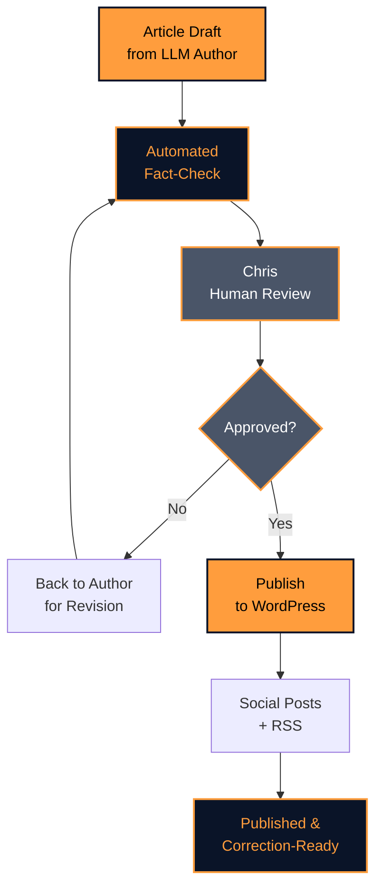

# Quality assurance

We publish AI-drafted articles. We're transparent about the AI involved and the quality gates every article passes through. Here's how we keep things trustworthy.

## Human in the loop

Every single article — whether it's a short daily broadcast or a longer weekly / monthly report — is reviewed by a human before it publishes. Chris reads the final draft, checks the facts against the sources, and makes the call. If something feels off, it doesn't go live. If something needs tweaking, we tweak it.

**The AI drafts. The human decides.** That's not a token gesture — it's the foundation of our editorial process.

## Automated fact-checking

Before Chris even sees an article, an AI model checks it against the articles the author read. How that works depends on the blog, because we're moving the blogs to a new publishing pipeline one at a time:

- **The Daily Broadcast** (since October 2026) has a dedicated fact-check step. It splits the post into individual claims — dates, numbers, names, mission details — and checks every one against the source articles. Anything the sources don't support is fixed or removed. Chris gets a log of every change, and of anything the checker wasn't sure about, before he publishes.
- **The other blogs** still use the older route: one editing model reviews the draft against the sources and tightens the headline, excerpt and SEO. They move to the new pipeline in the coming weeks.

This doesn't prevent every possible error, but it reduces copy-paste mistakes and accidental drift between the source and the published article.

!!! success "Fact-checking by default"
    Every article gets an automated check against its sources, and every article is read by Chris before it publishes.

## Source attribution

You'll always find a link back to the original story. Every factual claim should be traceable to its source. We don't paraphrase a claim and bury the source three paragraphs later — the link lives right where we use the information.

This serves two purposes:

1. **Verification** — you can click through and read the source yourself
2. **Credit** — we're an aggregator. The reporting isn't ours. The outlets and agencies who broke the story get the credit

## Corrections policy

Mistakes happen. When they do, we:

1. **Acknowledge** — publish a note or correction in the article itself (usually at the top)
2. **Fix** — update the article to reflect the correct information
3. **Explain** — say what was wrong and why (human error, source error, LLM misread, etc.)
4. **Log** — keep a running log of corrections for transparency

You should never have to second-guess whether something you read here is still accurate.

## Model transparency

Every article is credited to **Robo Chris**, and the author box at the end of each post says what Robo Chris is: an automated pipeline of API calls, filters and searches that also does a fair bit of writing. The models behind each step are listed on [Tech Stack](../technology/tech-stack.md), and this page explains what each step does.

We don't hide the AI. We name it. This matters because:

- **Different models have different strengths.** We say which ones we use, and for what.
- **Transparency builds trust.** We're not pretending this is 100% human-written. We're telling you what we built and who/what touched it — and letting you judge for yourself.
- **It's honest.** This is the cutting edge of publishing. Transparency about the method is part of the integrity.

---

## The QA stack

---

!!! success "Our QA commitment"
    Every article is fact-checked, every article is human-reviewed, every claim is sourced, and every error is corrected visibly. We're not perfect. But we're transparent about how we try.

*Next: [Technology →](../technology/index.md)*
